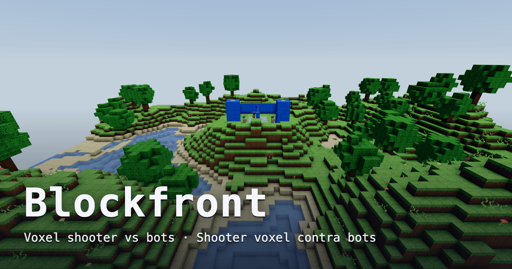

# Blockfront

[English](#english) · [Español](#español)

**Live:** [blockfront.riverogz.com](https://blockfront.riverogz.com)

<!-- TODO: gameplay GIF -->



---

## English

A voxel shooter for the browser: build, dig and fight in capture the flag, team deathmatch or free for all, offline against bots. No sign-up, no download, no server.

### How to play

Pick a mode, a size, a difficulty and a primary weapon in the menu and press **Play**. The first time it starts a team deathmatch, 4v4, against Soldier bots; after that it remembers your last setup.

| Mode                  | Win                      | Clock                       | Respawn                                        | Sizes              |
| --------------------- | ------------------------ | --------------------------- | ---------------------------------------------- | ------------------ |
| Capture the flag      | 3 captures               | 10 min + 2 min sudden death | Waves every 8 s at the base                    | 2v2, 3v3, 4v4, 6v6 |
| Team deathmatch (TDM) | First team to 25 kills   | 8 min, then most kills      | 4 s at the own base                            | 2v2, 3v3, 4v4, 6v6 |
| Free for all (FFA)    | First player to 15 kills | 8 min, then most kills      | 4 s at the spawn point farthest from any enemy | 4, 6, 8 players    |

To capture, your own flag must be at home. A suicide, a fall or drowning takes 1 point off your score in TDM and FFA.

**Controls** (desktop only: keyboard and mouse)

| Keys                                    | Action                                                  |
| --------------------------------------- | ------------------------------------------------------- |
| `WASD` · `Space` · `C` · `Shift`        | Move · jump / swim · crouch · sprint                    |
| `R`                                     | Reload                                                  |
| Left click · right click                | Use the item in hand · aim down sights (shovel: column) |
| Middle click                            | Copy the colour of the aimed block                      |
| `1` weapon · `2` pistol · `3` shovel    | Hotbar                                                  |
| `4` blocks (`4` again or wheel: colour) | Hotbar                                                  |
| `5` grenade · `6` TNT · `7` ladder      | Hotbar                                                  |
| `8` bandages (hold)                     | Heal                                                    |
| `G` · `Q`                               | Throw a grenade from any slot · previous slot           |
| `Tab` · `Esc` or `P` · `F3`             | Scoreboard · pause · stats                              |

**Difficulty.** No level cheats: they only change human parameters.

| Parameter                            | Recruit | Soldier   | Veteran |
| ------------------------------------ | ------- | --------- | ------- |
| Reaction time                        | 450 ms  | 300 ms    | 180 ms  |
| Field of view                        | 90°     | 110°      | 120°    |
| Max turn rate                        | 180°/s  | 300°/s    | 450°/s  |
| Initial aim error (shrinks tracking) | 6°      | 3.5°      | 1.5°    |
| Aims at the head                     | 0 %     | 25 %      | 60 %    |
| Memory of the last seen position     | 2 s     | 4 s       | 6 s     |
| Aims down sights beyond 15 blocks    | no      | yes       | yes     |
| Throws grenades                      | no      | sometimes | yes     |

### Features

- **Voxel world.** A 96 × 64 × 128 map generated from a seed and mirrored between the bases: river valley with a ford, hills, trees, plants and a fortified plateau per team. Procedural textures, skylight, sky dome and spherical fog.
- **Weapons and ADS.** Rifle, carbine, SMG, shotgun and bolt-action sniper as primaries, plus a pistol. Each gun has its own modelled sight, ADS time and zoom, a hip-fire spread that grows with movement, jumps and bursts, and its own recoil. The sniper has a hybrid scope and holds its breath with `Shift`.
- **Water and swimming.** Static water with its own shader, swimming and sprint-swimming, an air meter with drowning, and holes dug next to the river fill with water.
- **Building and destruction.** 50 blocks in eight colours, the shovel digs, bullets and blasts break blocks, grenades charge and show their arc, TNT can be defused with the shovel and ladders cancel fall damage. Blocks placed by a team only break for the enemy, so teammates cannot wreck your fort.
- **Chests.** 10 loot chests per map, mirrored. Touching one refills both reserves and gives +1 bandage and +1 grenade; it stays empty for 30 s.
- **CTF, TDM and FFA against bots**, from 2v2 to 6v6 or up to 8 players, with three difficulties, Tab scoreboard, compass with flags and chests, kill feed, death screen and an end panel with an MVP.
- **Product.** Settings saved in the browser (sensitivity, ADS sensitivity, FOV 70–100, three volumes, invert Y, FPS counter, reduced camera motion), Spanish and English, a loading screen that warms the workers up, and a "desktop only" page on touch devices.

### How it works

```
apps/client (Svelte 5 + Three.js)                      Web Workers
 ├─ render, HUD, audio                                  ├─ sim worker: packages/sim at 30 Hz
 ├─ input → one InputFrame per tick ── LocalTransport ─►│   (Game.step, bots, rules)
 │                                   ◄─ snapshot + events
 ├─ MesherPool ──────────────────────────────────────►  ├─ 2–4 mesher workers (greedy + AO)
 └─ SkylightTexture ─────────────────────────────────►  └─ light worker (first skylight fill)
apps/server: Cloudflare Worker serving the static build, plus GET /api/health
```

- **Deterministic simulation in a Web Worker at 30 Hz.** `packages/sim` is pure TypeScript with no DOM, Three.js or Worker imports (an ESLint rule enforces it). The client never touches the game state: it sends one `InputFrame` per tick and draws the snapshots and events, interpolating between ticks at the screen rate. A replay test checks that, on the same machine, the same seed and the same inputs give an identical `serialize()` and event stream, and that a mid-match save restores to the same state.
- **Own voxel engine.** Chunks of 32³ in a `Uint8Array` and a block registry with per-face textures. Greedy meshing with per-vertex ambient occlusion runs in a pool of mesher workers with transferables, and only the dirty chunks are remeshed. Skylight is a flood fill (sun columns plus BFS): the first fill runs in a worker, and each edit updates it incrementally. The physics is a swept AABB through the grid and the raycast is a DDA (Amanatides–Woo). The 18 texture layers are baked in code into a `DataArrayTexture` and drawn by custom GLSL3 shaders.
- **Bots that perceive like a human.** A bot builds its own `InputFrame` every tick and goes through the same rules as the player. `perception.ts` is the only code that reads other players: sight is a DDA ray from the eye to the head and torso, inside the field of view and up to 70 blocks; hearing places shots and footsteps ±3 blocks off. There is no wallhack. Navigation is A* over the voxel grid (walk, jump 1, drop up to 3, swim) with a budget of 2,000 nodes per tick shared by every bot, plus stuck rules that jump, dig and re-route. Goals are chosen by utility (fight, heal, ammo, search, mode objective, noise), and in CTF a commander per team hands out attack, defend and escort roles.
- **Headless harness.** `npm run bots:bench` plays bot-only matches in Node at full speed and reports duration, winner, captures, kills, accuracy per difficulty, time stuck per bot and the ms per `Game.step`.
- **Audio from real recordings, in layers.** Each shot mixes a mechanical click, the "behind the shooter" take from the Free Firearm Sound Library, a synthetic low thump and a tail. Enemy shots pick a near, mid or far take by distance and are low-passed and delayed at the speed of sound. A shared convolution reverb follows how enclosed the listener is (short DDA rays), and voice limits, buses, ducking, a compressor and a limiter keep the mix clean. Clips ship as Opus WebM with an AAC fallback.

**Stack:** Svelte 5 · Vite 8 · Tailwind v4 · Three.js r186 · TypeScript (strict) · Vitest · Cloudflare Workers

### Measured numbers

Taken from [`docs/progress.md`](docs/progress.md). Node 22 on Apple silicon unless noted.

| Metric                                     | Value                                                                     | Budget            |
| ------------------------------------------ | ------------------------------------------------------------------------- | ----------------- |
| Initial JS (gzip)                          | app 80.5 KB + three 161.5 KB; sim worker 28.2 KB                          | < 600 KB          |
| Audio downloaded by a client               | one format only (Opus or AAC); 1.2 MB on disk for both                    | —                 |
| First match download                       | 412 KB transferred until the menu shows (2.2 s, local production preview) | < 5 MB            |
| Menu ready after navigation                | ~2.5 s (built preview, headless Chrome with software WebGL)               | playing in < 5 s  |
| Frame CPU                                  | 0.3 ms (viewmodel pass + particles, F2, hidden tab)                       | —                 |
| fps                                        | 59.7 avg, p99 18.7 ms in a TDM 6v6 (Chrome, Mac, DPR 2)                   | 60 stable         |
| Mesher per chunk                           | 2.83 ms avg / 4.62 ms max                                                 | < 5 ms            |
| Skylight                                   | 85 ms for the whole map; 0.05 ms avg per edit                             | —                 |
| `Game.step` with 12 bots (TDM 6v6 Veteran) | avg 0.51 ms, p99 5.58 ms                                                  | avg < 4, p99 < 12 |
| Tests                                      | 324 in `sim`, 36 in the client                                            | —                 |

Bot harness results:

| Check                                        | Result                           |
| -------------------------------------------- | -------------------------------- |
| CTF 4v4 Veteran: a capture within 10 minutes | 82.5 % of 40 matches             |
| TDM and FFA end by score                     | 83–100 % in every size and level |
| Time stuck per bot                           | worst bot 4.5 %, mean ≤ 0.4 %    |
| Veteran against Recruit, mixed TDM 4v4       | Veteran won 20 of 20             |

### Decisions and trade-offs

- **Three.js and an own engine, not Unity or Godot.** The web exports of Unity and Godot start at 5–10 MB and hide the code; Three.js plus a small voxel engine stays well under 1 MB of JS, loads in seconds and keeps every system readable in the repo.
- **Offline against bots.** The game runs entirely in the browser and the Worker only serves static files, so it costs nothing and has no quota to watch.
- **Multiplayer was dropped** on 2026-11-13 because of the cost of maintaining it, not because of the engine. It was designed (an authoritative room per match on Durable Objects, prediction, interpolation and lag compensation), and the `Transport` interface between client and simulation is still the seam where a socket transport would plug in.
- **Bots dig when they get stuck but never build or place TNT.** Building bots were left out of the final scope to close the project.
- **The reinforced block was removed** because it turned the flag into a bunker and killed captures. For the same reason, a team's blocks only break for the enemy.
- **Desktop only.** A touch FPS is a different project.
- **Tests only where logic is pure and risky:** raycast, AABB sweep, meshing, damage, rules, bots and replay. `typecheck`, `lint` and `build` run in CI before anything else.

### Development

Requires Node 22.12 or later.

```bash
npm install
npm run dev              # client with hot reload (Vite)
npm run preview          # production build served by the Worker (wrangler dev)
npm run typecheck && npm run lint && npm test
npm run check:qa-absent  # builds and fails if any QA hook reaches dist
npm run deploy:check     # build + wrangler deploy --dry-run
```

- **QA mode:** in the dev server only, `?qa=1` runs the match without pointer lock and exposes `window.blockfront.qa` (inject keys, teleport, give items, read state, wait for events). Production builds strip it, and `check:qa-absent` verifies that.
- **Bot harness:**

  ```bash
  npm run bots:bench -- --mode ctf --size 4 --difficulty veteran --matches 10
  # --blue X --red Y for mixed teams, --seed map, --offset first variant, --json
  ```

- In dev builds `F` toggles a free camera and `H` shows the hitboxes.
- `scripts/audio/build.mjs` rebuilds the gun audio from the listed CC0 sources.

### Inspiration

The mechanics are inspired by Blockade 3D (2014) and the "Minecraft with guns" family: building forts on the fly, blocks per life restocked at the base, simple gunplay and a fixed arsenal. Only the mechanics: no names, maps, models, sounds or code from that game.

### License and credits

The source code is released under the [MIT License](LICENSE). Every third-party asset (models and recorded sounds) is CC0 and listed with its author, source and use in [`assets/CREDITS.md`](assets/CREDITS.md). The guns, textures and chests are made in code, and a few sounds are synthesized (with `ffmpeg` or Web Audio).

### Author

Developed by **Jhon Rivero** — [GitHub](https://github.com/JhonRiv21) · [Portfolio](https://jhon.riverogz.com/)

---

## Español

Un shooter voxel en el navegador: construye, cava y pelea en captura la bandera, duelo por equipos o todos contra todos, sin conexión y contra bots. Sin registro, sin descargas y sin servidor.

### Cómo se juega

En el menú eliges el modo, el tamaño, la dificultad y el arma primaria, y pulsas **Jugar**. La primera vez arranca un duelo por equipos 4v4 contra bots de nivel Soldado; después recuerda tu última configuración.

| Modo                     | Victoria                     | Reloj                             | Reaparición                                            | Tamaños            |
| ------------------------ | ---------------------------- | --------------------------------- | ------------------------------------------------------ | ------------------ |
| Captura la bandera (CTF) | 3 capturas                   | 10 min + 2 min de muerte súbita   | Oleadas cada 8 s en la base                            | 2v2, 3v3, 4v4, 6v6 |
| Duelo por equipos (TDM)  | El primer equipo a 25 bajas  | 8 min; luego gana quien lleve más | 4 s en la base propia                                  | 2v2, 3v3, 4v4, 6v6 |
| Todos contra todos (FFA) | El primer jugador a 15 bajas | 8 min; luego gana quien lleve más | 4 s en el punto de aparición más lejano a los enemigos | 4, 6, 8 jugadores  |

Para capturar, tu bandera debe estar en tu base. Un suicidio, una caída o ahogarse te restan 1 punto en TDM y FFA.

**Controles** (solo escritorio: teclado y ratón)

| Teclas                                    | Acción                                                      |
| ----------------------------------------- | ----------------------------------------------------------- |
| `WASD` · `Espacio` · `C` · `Shift`        | Mover · saltar / nadar · agacharse · correr                 |
| `R`                                       | Recargar                                                    |
| Clic izquierdo · clic derecho             | Usar lo que tienes en la mano · apuntar (pala: columna)     |
| Clic medio                                | Copiar el color del bloque apuntado                         |
| `1` arma · `2` pistola · `3` pala         | Barra de ítems                                              |
| `4` bloques (`4` de nuevo o rueda: color) | Barra de ítems                                              |
| `5` granada · `6` TNT · `7` escalera      | Barra de ítems                                              |
| `8` vendas (mantener)                     | Curarse                                                     |
| `G` · `Q`                                 | Lanzar una granada desde cualquier ranura · ranura anterior |
| `Tab` · `Esc` o `P` · `F3`                | Marcador · pausa · estadísticas                             |

**Dificultad.** Ningún nivel hace trampa: solo cambian parámetros humanos.

| Parámetro                                       | Recluta | Soldado | Veterano |
| ----------------------------------------------- | ------- | ------- | -------- |
| Tiempo de reacción                              | 450 ms  | 300 ms  | 180 ms   |
| Campo de visión                                 | 90°     | 110°    | 120°     |
| Giro máximo                                     | 180°/s  | 300°/s  | 450°/s   |
| Error de puntería inicial (se reduce siguiendo) | 6°      | 3,5°    | 1,5°     |
| Apunta a la cabeza                              | 0 %     | 25 %    | 60 %     |
| Memoria de la última posición vista             | 2 s     | 4 s     | 6 s      |
| Usa la mira a más de 15 bloques                 | no      | sí      | sí       |
| Lanza granadas                                  | no      | a veces | sí       |

### Características

- **Mundo voxel.** Un mapa de 96 × 64 × 128 generado por semilla y en espejo entre las bases: valle con río y vado, colinas, árboles, plantas y una meseta fortificada por equipo. Texturas procedurales, luz de cielo, bóveda celeste y niebla esférica.
- **Armas y mira (ADS).** Fusil, carabina, subfusil, escopeta y francotirador de cerrojo como primarias, más una pistola. Cada arma tiene su mira modelada, su tiempo de ADS y su zoom, una dispersión desde la cadera que crece al moverse, saltar o disparar seguido, y su propio retroceso. El francotirador tiene un telescopio híbrido y contiene la respiración con `Shift`.
- **Agua y nado.** Agua estática con su propio shader, nado y nado rápido, medidor de aire con ahogo, y los huecos que se cavan junto al río se llenan de agua.
- **Construcción y destrucción.** 50 bloques en ocho colores, la pala cava, las balas y las explosiones rompen bloques, la granada se carga y muestra su arco, la TNT se desactiva con la pala y la escalera anula el daño por caída. Los bloques de un equipo solo los rompe el enemigo, así que un compañero no puede tumbarte el fuerte.
- **Cofres.** 10 cofres de botín por mapa, en espejo. Tocar uno repone ambas reservas y da +1 venda y +1 granada; queda vacío 30 s.
- **CTF, TDM y FFA contra bots**, de 2v2 a 6v6 o hasta 8 jugadores, con tres dificultades, marcador con Tab, brújula con banderas y cofres, feed de bajas, pantalla de muerte y pantalla final con MVP.
- **Producto.** Ajustes guardados en el navegador (sensibilidad, sensibilidad al apuntar, FOV 70–100, tres volúmenes, invertir Y, contador de FPS, menos movimiento de cámara), español e inglés, una pantalla de carga que precalienta los workers y una página «Solo escritorio» en dispositivos táctiles.

### Cómo funciona por dentro

```
apps/client (Svelte 5 + Three.js)                      Web Workers
 ├─ render, HUD, audio                                  ├─ sim worker: packages/sim a 30 Hz
 ├─ input → un InputFrame por tick ── LocalTransport ─► │   (Game.step, bots, reglas)
 │                                   ◄─ snapshot + eventos
 ├─ MesherPool ──────────────────────────────────────►  ├─ 2–4 workers de mallado (greedy + AO)
 └─ SkylightTexture ─────────────────────────────────►  └─ worker de luz (primer relleno)
apps/server: Worker de Cloudflare que sirve el build estático, más GET /api/health
```

- **Simulación determinista en un Web Worker a 30 Hz.** `packages/sim` es TypeScript puro, sin DOM, Three.js ni APIs de Workers (una regla de ESLint lo impone). El cliente nunca toca el estado del juego: envía un `InputFrame` por tick y dibuja los snapshots y eventos, interpolando entre ticks a la tasa de la pantalla. Una prueba de repetición comprueba que, en la misma máquina, la misma semilla y los mismos inputs dan un `serialize()` y un flujo de eventos idénticos, y que una partida guardada a mitad se restaura al mismo estado.
- **Motor voxel propio.** Chunks de 32³ en un `Uint8Array` y un registro de bloques con textura por cara. El greedy meshing con oclusión ambiental por vértice corre en un pool de workers con transferables, y solo se vuelven a mallar los chunks sucios. La luz de cielo es un flood fill (columnas de sol más BFS): el primer relleno corre en un worker y cada edición la actualiza de forma incremental. La física es un AABB barrido por la grilla y el raycast es un DDA (Amanatides–Woo). Las 18 capas de textura se hornean en código en una `DataArrayTexture` y las dibujan shaders GLSL3 propios.
- **Bots que perciben como un humano.** Un bot arma su propio `InputFrame` en cada tick y pasa por las mismas reglas que el jugador. `perception.ts` es el único código que lee a los demás jugadores: la vista es un rayo DDA del ojo a la cabeza y al torso, dentro del campo de visión y hasta 70 bloques; el oído ubica disparos y pasos con ±3 bloques de error. No hay wallhack. La navegación es A* sobre la grilla de voxels (caminar, saltar 1, caer hasta 3, nadar) con un presupuesto de 2.000 nodos por tick compartido entre todos los bots, más reglas de atasco que saltan, cavan y cambian de ruta. Las metas se eligen por utilidad (pelear, curarse, munición, buscar, objetivo del modo, ruido) y en CTF un comandante por equipo reparte los roles de ataque, defensa y escolta.
- **Harness headless.** `npm run bots:bench` juega partidas solo de bots en Node a máxima velocidad y reporta duración, ganador, capturas, bajas, precisión por dificultad, tiempo atascado por bot y ms por `Game.step`.
- **Audio con grabaciones reales, en capas.** Cada disparo mezcla un clic mecánico, la toma «detrás del tirador» de la Free Firearm Sound Library, un golpe grave sintético y una cola. Los disparos enemigos eligen la toma cercana, media o lejana según la distancia, con pasa-bajos y el retardo de la velocidad del sonido. Una reverb por convolución compartida sigue qué tan encerrado está el oyente (rayos DDA cortos), y los límites de voces, los buses, el ducking, un compresor y un limitador mantienen limpia la mezcla. Los clips van en Opus WebM con respaldo AAC.

**Stack:** Svelte 5 · Vite 8 · Tailwind v4 · Three.js r186 · TypeScript (strict) · Vitest · Cloudflare Workers

### Cifras medidas

Tomadas de [`docs/progress.md`](docs/progress.md). Node 22 en Apple silicon salvo que se indique.

| Métrica                                    | Valor                                                                      | Presupuesto         |
| ------------------------------------------ | -------------------------------------------------------------------------- | ------------------- |
| JS inicial (gzip)                          | app 80,5 KB + three 161,5 KB; worker de sim 28,2 KB                        | < 600 KB            |
| Audio que descarga un cliente              | un solo formato (Opus o AAC); 1,2 MB en disco con ambos                    | —                   |
| Descarga de la primera partida             | 412 KB transferidos hasta ver el menú (2,2 s, preview local de producción) | < 5 MB              |
| Menú listo tras navegar                    | ~2,5 s (preview del build, Chrome headless con WebGL por software)         | jugando en < 5 s    |
| CPU por fotograma                          | 0,3 ms (pase del arma + partículas, F2, pestaña oculta)                    | —                   |
| fps                                        | 59,7 de promedio, p99 18,7 ms en un TDM 6v6 (Chrome, Mac, DPR 2)           | 60 estables         |
| Mallado por chunk                          | 2,83 ms promedio / 4,62 ms máximo                                          | < 5 ms              |
| Luz de cielo                               | 85 ms el mapa entero; 0,05 ms promedio por edición                         | —                   |
| `Game.step` con 12 bots (TDM 6v6 Veterano) | promedio 0,51 ms, p99 5,58 ms                                              | prom. < 4, p99 < 12 |
| Tests                                      | 324 en `sim`, 36 en el cliente                                             | —                   |

Resultados del harness de bots:

| Criterio                                          | Resultado                        |
| ------------------------------------------------- | -------------------------------- |
| CTF 4v4 Veterano: una captura antes de 10 minutos | 82,5 % de 40 partidas            |
| TDM y FFA terminan por puntuación                 | 83–100 % en cada tamaño y nivel  |
| Tiempo atascado por bot                           | peor bot 4,5 %, promedio ≤ 0,4 % |
| Veterano contra Recluta, TDM 4v4 mixto            | Veterano ganó 20 de 20           |

### Decisiones y descartes

- **Three.js y un motor propio, no Unity ni Godot.** Las exportaciones web de Unity y Godot arrancan con 5–10 MB y ocultan el código; Three.js más un motor voxel pequeño queda muy por debajo de 1 MB de JS, carga en segundos y deja cada sistema legible en el repo.
- **Sin conexión, contra bots.** El juego corre entero en el navegador y el Worker solo sirve archivos estáticos, así que no cuesta nada y no hay cuota que vigilar.
- **El multijugador se descartó** el 2026-11-13 por el costo de mantenerlo, no por el motor. Estaba diseñado (una sala autoritativa por partida en Durable Objects, predicción, interpolación y compensación de lag), y la interfaz `Transport` entre el cliente y la simulación sigue siendo el punto donde se conectaría un transporte por socket.
- **Los bots cavan cuando se atascan, pero no construyen ni ponen TNT.** Los bots constructores quedaron fuera del alcance final para cerrar el proyecto.
- **Se quitó el bloque reforzado** porque convertía la bandera en un búnker y mataba las capturas. Por lo mismo, los bloques de un equipo solo los rompe el enemigo.
- **Solo escritorio.** Un FPS táctil es otro proyecto.
- **Tests solo donde la lógica es pura y riesgosa:** raycast, barrido AABB, mallado, daño, reglas, bots y repetición. `typecheck`, `lint` y `build` corren en CI antes que nada.

### Desarrollo

Requiere Node 22.12 o superior.

```bash
npm install
npm run dev              # cliente con recarga en caliente (Vite)
npm run preview          # build de producción servido por el Worker (wrangler dev)
npm run typecheck && npm run lint && npm test
npm run check:qa-absent  # compila y falla si algún hook de QA llega a dist
npm run deploy:check     # build + wrangler deploy --dry-run
```

- **Modo QA:** solo en el servidor de desarrollo, `?qa=1` corre la partida sin capturar el ratón y expone `window.blockfront.qa` (inyectar teclas, teletransportar, dar ítems, leer el estado, esperar eventos). El build de producción lo elimina, y `check:qa-absent` lo verifica.
- **Harness de bots:**

  ```bash
  npm run bots:bench -- --mode ctf --size 4 --difficulty veteran --matches 10
  # --blue X --red Y para equipos mixtos, --seed mapa, --offset primera variante, --json
  ```

- En los builds de desarrollo, `F` activa la cámara libre y `H` muestra las hitboxes.
- `scripts/audio/build.mjs` regenera el audio de armas desde las fuentes CC0 listadas.

### Inspiración

Las mecánicas se inspiran en Blockade 3D (2014) y en la familia «Minecraft con armas»: fuertes construidos al vuelo, bloques por vida que se reponen en la base, gunplay simple y un arsenal fijo. Solo las mecánicas: nada de nombres, mapas, modelos, sonidos ni código de ese juego.

### Licencia y créditos

El código fuente se publica bajo la [licencia MIT](LICENSE). Todos los assets de terceros (modelos y sonidos grabados) son CC0 y están listados con su autor, su fuente y su uso en [`assets/CREDITS.md`](assets/CREDITS.md). Las armas, las texturas y los cofres están hechos en código, y algunos sonidos son sintetizados (con `ffmpeg` o Web Audio).

### Autor

Desarrollado por **Jhon Rivero** — [GitHub](https://github.com/JhonRiv21) · [Portafolio](https://jhon.riverogz.com/)
